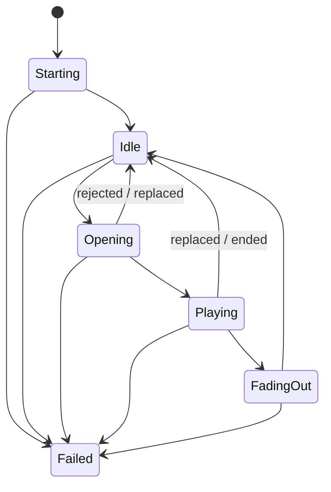

# ExperienceX maintenance guide

`Lighting` owns WLED resolution, desktop capture, Jinx-compatible smoothing, constrained LED geometry and composed DDP output. Shared Networking distributes Controller-owned LED perspectives through existing definitions. Guides use a capture-excluded DirectComposition window; actual content stays capturable. DisplayManager owns output-worker and guide-window shutdown. Tests use temporary configuration and loopback WLED simulation.

ExperienceX uses C# and Direct3D 11. The application namespace is `ExperienceX`. Camera and the original Experience remain separate applications. Camera and ExperienceX share the [UDP broadcast protocol](../NETWORKING.md); playback bodies include device/source/requestId. ExperienceX uses per-display playback, independent audio and a hostname configuration file in OneDrive.

## Source layout and ownership

| Folder | Responsibility |
|---|---|
| Application | Startup composition, request routing, and owned asynchronous work |
| Configuration | Local profile paths, first-run template seeding, defaults, validation, schema upgrades, atomic saves, and live reloads |
| Networking | UDP reception, request parsing, and retry deduplication |
| MediaDistribution | Root-only Controller downloads into the local profile, conflict tracking, and atomic file replacement |
| ../Shared/Networking | Shared broadcast envelope, device identity, sender/retries, listening sockets and bounded deduplication for Camera and ExperienceX |
| Windows | Display discovery, window lifetime, availability, and topmost behavior |
| Video | Rendering worker, GPU resources, Media Foundation session, playback timeline, counters, and recovery policy |
| Visualization | Owned G-Force process/job lifetime, loopback SSMP control/fullscreen, launch defaults, live edits, closed visual commands, display placement and recovery |
| Audio | Device discovery, prepared playback, channel routing, and sample-based fades |
| Calibration | Editing, undo, geometry validation, overlays, labels, and save confirmations |
| Media | Local media assets, always excluded from Git; Application/MediaPath resolves requests safely |
| Shaders | HLSL and embedded compiled shader resources |

`ExperienceHost` wires services together and routes requests. `ConfigurationService` owns its watcher, debounce timer, polling timer, current validated snapshot, and reload task. `UdpExperienceListener` owns the socket and receive-loop cancellation. `DisplayManager` owns display notifications, its one-second check timer, and windows. `AudioManager` owns active audio tracks; the host owns preparation tasks. Each audio request owns a shared-mode WASAPI stream and an immutable sample-volume multiplier, so requests can overlap on the same endpoint/channel. Completion removes only that playback object; disconnect disposes every track on the affected endpoint. Video replacement is per screen.

## Thread and resource rules

The WPF dispatcher owns application options, routing, window operations, the active audio-track collection, and calibration edits. File I/O and audio preparation run in background tasks, returning to the dispatcher before changing application state. `LocalControllerConnection` polls only loopback HTTP for the local Controller's combined catalog. `ControllerDefinitionsCache` owns the dispatcher-side perspective cache. Media copies come only from the local Controller folder through shared `MediaCache`; Experience performs no SMB discovery. ControllerPeers owns remote discovery, bounded definition downloads, share credentials and serialized peer-media copies on background workers. Controllers expose their own definitions separately from the union to prevent recursive relay loops. Downloads commit atomically after cancellation/source-stability checks, retain local extras, and track per-file ownership to avoid silently replacing another Controller's media. `AsyncTaskScope` tracks and observes asynchronous work, prevents new work during shutdown, cancels pending work, and waits up to five seconds for completion. OS-blocked SMB calls may outlast this wait on their background worker.

`AudioDeviceSelection` resolves single devices, comma lists, arrays, virtual groups and the default, deduplicating physical endpoint IDs. Multi-output requests use `CoordinatedAudioPlayback`, whose dedicated thread owns every WASAPI client, shared decoder and buffer event. Preparation is gated before a common future start; cancellation releases all prepared resources even before that gate opens. `CoordinatedAudioOutput` maps queued frames to QPC using `AudioClockMapping`; `AudioSynchronizationCursor` adjusts a continuous source cursor rather than periodically seeking. `AudioResampler` uses polyphase windowed-sinc interpolation. `SharedAudioSource` keeps bounded history sized for downstream latency differences and decodes once per request. Options and inventory snapshots cross threads through volatile references. Device removal affects only that endpoint. Group disposal cancels, wakes and joins its worker before releasing handles; a timed-out worker retains ownership until it exits. Endpoint timing estimates exclude unreported speaker processing and acoustic travel time.

Each `VideoRenderer` has one dedicated render worker and shared graphics device/swap chain per display. Each `DisplayScreenTrack` owns editing state and an overlay on that worker; video screens own a decoder/texture/timeline, while mat screens use cached triangulated geometry. Video and persistent opaque black mats composite together in configuration order, then all editing overlays. G-Force is an external background with one owned inverse polygon mat drawn first beneath all ordinary content layers. Its screen points describe the mask, while the external window stays fullscreen. The mask uses cached complement triangles and has no independently selectable screen entry. Point edits alone rebuild mat geometry; idle mats do not require a continuous render loop. Screen IDs retain identity through name changes; per-display arrays retain explicit zero-screen configurations. `GraphicsResources`, `MediaEngineSession`, `CalibrationOverlay`, `PlaybackMetrics`, the transform cache, and the playback timeline belong to that worker. Media callbacks publish flags and wake the worker; they do not draw or manipulate windows. Cross-thread renderer requests use the bounded, coalescing mailbox. All GPU and media disposal remains on the worker, including failure paths. Debug builds check the graphics-resource owner thread.

Use immutable option snapshots when passing configuration to the worker. Do not mutate their dictionary contents after publication. Shader constant structures must continue to match the HLSL packing and GPU readback checks.

`RoleList` shares comma-list parsing and case-insensitive matching with Controller. Role commands broadcast once rather than expanding a discovery snapshot into many remote commands. `ScreenSelection` and `AudioDeviceSelection` resolve the current local hardware and configuration, preserving ordinary media-type filtering and deduplication. `AudioDeviceOptions` combines physical/group roles; the atomic configuration store adds descriptive entries for new endpoints without replacing assignments. Inventories publish effective roles so Controller can display the same routing metadata. Role matching stays on the dispatcher/preparation path and never runs per video frame.

Screen-name browsing stays on the dispatcher. `ScreenMediaCatalog` supplies sorted, unambiguous local names; `ScreenMediaNameCycle` wraps them around a persisted zero-position `DefaultName`. The native name editor consumes bare Left/Right only while open. `MainWindow` serializes a bounded direction queue through the host's existing atomic rename/reload path, allows its own pending name through live reload, and cancels editing on unrelated remote renames. Enter/Tab waits for pending browsing saves. Playback reacts through normal media-name binding, without an additional playback command path. New screen names reserve existing `DefaultName` values so returning to zero remains possible after restart.

Per-screen `Brightness` is a validated percentage with a default of 100. The host queues each +/- press with the selected display/screen identity, serializes relative changes through configuration read/merge/write, and reloads before reporting success. The renderer applies it as `Aspect.W` in the existing video/image shader constants. RGB is scaled after source-alpha recovery and chroma-key calculation; alpha, transition timing, display backgrounds, mats and editing overlays remain independent. Configuration changes request a redraw, including for static images, without reopening media.

## State and timing

`RendererStateMachine` validates transitions:



A failed worker is recreated; it does not transition back into playback. Recovery returns to idle with the configured display background. `VideoPlaybackTimeline` starts only after an advancing frame has been submitted at zero opacity, and computes fades against the natural media end. Completion submits and commits a frame with transparent video over the configured background before closing the media session. `PlaybackMetrics` records the same event fields independently of scheduling.

Looping video enables the Media Engine's loop property and keeps the same timeline across media rewinds. Natural-end fading is disabled for loops. A source + original-request-ID stop starts the configured fade from the current alpha without disabling native looping, so decoding continues until transparent completion. `VideoStopHistory` is owned by the dispatcher and independently by each renderer worker to suppress reordered play commands at both routing and mailbox boundaries; it holds at most 4096 canceled IDs for the configured deduplication window.

`ScreenMediaMonitor` publishes an immutable `ScreenMediaCatalog` to routing and all display workers. Initial inventory precedes UDP binding; subsequent metadata scans run off the dispatcher every second. Screen names resolve to local filenames or unique basenames. `DisplayScreenTrack` owns the derived binding and enforces it again at the renderer mailbox boundary; binding changes replace content, unchanged bindings preserve playback, failures retry after five seconds, and display unavailability pauses automatic playback. An ambiguous basename remains locked without selecting an arbitrary file. These locks affect playback commands, not calibration or screen configuration. No additional configuration property is persisted.

Still images are decoded to premultiplied BGRA once on the worker, uploaded to a cached texture, and use the existing point transform, sizing and premultiplied compositor. Premultiplying before texture filtering prevents dark image-edge halos. `Aspect.Z` selects source-alpha preservation for images; ordinary video retains its prior alpha behavior. Once an image's initial fade completes, the renderer sleeps until a redraw is needed. Automatic media bindings are supplied to recreated workers so content resumes after recovery.

## Configuration evolution

The live file is `%OneDrive%\Home Technologies\Bin\ExperienceX\appsettings.<computer-name>.json`, beside the defaults template. Shared `MachineConfigurationFiles` resolves the OneDrive root and Windows hostname and seeds a missing file atomically from validated defaults. Existing hostname files and backups take precedence. Builds and launchers exclude working files; hardware inventory and edits persist only in the hostname file. Old user-profile settings are ignored. `MediaPath` resolves relative audio/video directories independently under `%LOCALAPPDATA%\Home Technologies\ExperienceX`. Discovery downloads there; cache and decoder entry points reject network storage, with no remote playback fallback.

`ExperienceOptions` is the source of defaults and validation. `ConfigurationSchema` owns JSON parsing policy and ordered schema migrations. Unversioned configuration is version 0; version 1 preserves legacy names, adds their current equivalents when absent, and retains unknown fields. Version 3 renames monitor fields to display fields, separates UDP events/commands ports, and migrates per-display keystones to named screen arrays. Version 2 converts legacy display background strings to separate `BackgroundColor` and `IsTransparent` fields. Detected displays lacking settings receive persisted black/opaque defaults. Version 4 replaces screen keystones with a shared clockwise point list, preserving existing video geometry and enabling arbitrary concave mat polygons. `PointConfigurationStore` persists migration/default additions and targeted transparency toggles atomically, preserving unrelated fields and retaining the preceding file as `.bak`. Unsupported future versions are rejected without downgrade or overwrite.

For a new setting, add its default and validation to the options model, determine whether it applies live, and update the README. For a structural change, add an explicit schema migration and tests for old files, new files, unknown fields, and rejection of newer unsupported versions. Preserve external-editor locking and the accepted-settings/render-confirmation ordering.

## Shutdown

Closing a production window first requests application shutdown without immediately destroying its HWND. The app awaits the host while the dispatcher continues pumping. The host stops UDP/configuration producers, drains calibration and preparation work, closes audio, then asks all windows to stop recovery and render workers. Worker disposal is bounded and never moves GPU cleanup onto the UI thread. The single-instance mutex and telemetry remain alive until this sequence completes.

## Verification and formatting

Shared telemetry attaches an immutable `RequestLogContext` snapshot at enqueue time. Producers register context before dispatch; ExperienceX registers received context and updates it after resolving local media. The logger keeps the most recent 4096 request contexts, including recently completed playback for late callbacks. Command context is optional protocol metadata and never controls routing or scheduling. Use `ExperienceX.Tests -- --context` to verify serialization, lifecycle/failure log enrichment and bounded retention.

Tests use a `ProjectReference` to the actual application and `InternalsVisibleTo`; do not link copies of production `.cs` files into the test assembly. Fast checks live in `ExperienceX.Tests/Unit`; GPU and native-window checks live in `ExperienceX.Tests/Hardware`. The runner returns a nonzero exit code on failure and uses no extra test framework dependency.

```powershell
# Fast checks: no GPU or audio-device initialization.
dotnet run --project ExperienceX.Tests/ExperienceX.Tests.csproj
# GPU readback, device loss/recovery and window tests only.
dotnet run --project ExperienceX.Tests/ExperienceX.Tests.csproj -- --hardware
# All checks.
dotnet run --project ExperienceX.Tests/ExperienceX.Tests.csproj -- --all
```

Stop the applications before any build, including an implicit build from `dotnet run`. Build copying can be disabled with `-p:CopyBuildOutputToOneDrive=false` for verification. Project-referenced test builds disable deployment of the referenced app. Live scripts additionally verify real displays/audio devices and restore the local configuration; they are separate from the fast suite.

Each project has an `.editorconfig`. Format from its directory with `dotnet format whitespace . --folder --exclude bin obj`. Append `--verify-no-changes` for a formatting check. Compiled shaders stay checked in; use `Compile-Shaders.ps1` when HLSL changes.

## Visualization ownership

`DisplayManager` calls `VisualizationManager` on its one-second display inventory timer and awaits its shutdown before disposing output windows. Configuration permits one fullscreen visualization overall because simultaneous Standalone fullscreen instances failed local tests. Each instance starts hidden, establishes a normal rendering window on its target display without activation, and then enters actual fullscreen. Bounds are checked against the physical display; screen deletion, display/renderer loss or configuration changes close that owned process. A failed process or missing/fullscreen window retries with 2–30 second backoff; stable operation resets it after 30 seconds. The Windows job kills owned descendants if Experience exits unexpectedly, preserving unrelated vendor instances. Native show/position operations avoid activation and request asynchronous window processing; fullscreen delivery has a one-second timeout.

Visualization tracks provide only configuration selection/name overlays. Positive `IsVideo` filtering protects command routing, media binding and video-specific controls. Visualization points are fixed to the display; no draggable point handles are rendered. `DisplayBackground.For` derives transparency without changing the stored background.

## Point snapping

`PointSnapping` owns the immutable original shapes, mutable drag drafts, coincident point group and snap mementos for one display. It selects the nearest eligible point within the existing hit radius; ties follow screen/point definition order. A joined group receives exactly one shared coordinate. Validation limits movement for every affected media quad/mat polygon together and prevents self-collapse. Exact coordinate equality defines a persistent join without extra configuration metadata. Visualization geometry is excluded. Whole-screen interior dragging retains independent translation.

`PointCalibration` owns the selected point across mouse release, temporary detachment/snap-undo suppression, multi-screen undo frames and remote-change invalidation. `ScreenSurface.PreviewPointGroup` submits all previews through one renderer mailbox command; selected overlays draw last. `PointConfigurationStore.SaveManyAsync` validates every participant before mutating any JSON and atomically merges all changed coordinates while preserving unrelated settings. Local confirmations suppress duplicate remote flashes for every member. Undo frames are shared by affected screens and invalidated together when a participant changes remotely. Temporary detachment ends after leaving the shared hit radius or configuration mode; no link IDs or detachment fields are persisted.

## Playback priorities and background ownership

`VideoPlaybackPriority` reserves each display/screen independently, including pending opens. Low, Medium and High are wire values shared with Controller; looping video is always Low. Equal-priority different-file requests replace; lower requests are rejected. Same-file identities ignore loop/mute flags so promotion never interrupts the existing decoder. The renderer owns handoff, disposal and frame-boundary changes.

`DisplayScreenTrack` remembers only the most recent background loop per screen. A blocked loop may update this background without replacing the foreground. Natural completion releases its reservation and reacquires Low before resuming; a queued higher reservation can still prevent resumption. Same-video one-shots preserve looping, with higher protection released at the next natural wrap. Matching stops remove background ownership; stale source/request IDs cannot stop replacements. Non-device foreground errors can resume a different valid background, while a failing background is not reopened recursively. Audio mixes across priorities. Media and GPU operations stay on the render worker.
